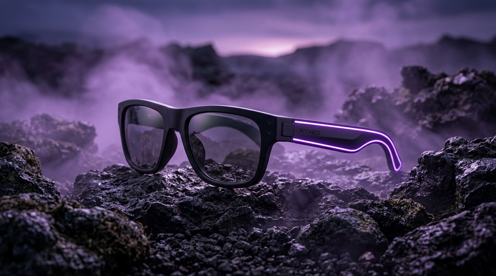

# 🕶️ VEXA — Smart Eyewear

> **VOYEZ PLUS. FAITES PLUS.**  
> Next-Gen AI Connected Glasses with 4K Camera, Open-Ear Spatial Audio, and Neural Multimodal Assistant.



---

## 🌟 Présentation du Projet

**VEXA** est une vitrine technologique et plateforme e-commerce moderne conçue pour une nouvelle génération de lunettes connectées alliant haute couture, optique de pointe (verres solaires polarisés / correcteurs), audio directionnel à oreille libre, capteur photo/vidéo 4K stabilisé et assistant d'intelligence artificielle multimodal.

---

## 🚀 Les 4 Univers de l'Application

1. **🌌 Hero & Expérience de Marque (Dark Cyberpunk)**
   - Rendu 3D macro des lunettes VEXA sur roche texturée avec halo néo-violet.
   - Barre des 5 piliers technologiques : Caméra 4K, Audio ouvert, Assistant IA, Autonomie 8h, Solaires & vue.
2. **🛍️ Configurateur Produit & Achat Direct (VEXA ONE - 299€)**
   - Visionneuse multi-angles et badge d'interaction 360°.
   - Sélecteur de 4 teintes de monture (*Noir Mat Onyx, Bleu Nuit, Vert Canopée, Écaille Ambrée*).
   - Sélecteur de verres (*Solaire polarisé, Correction clair, Prescription teinté*).
   - Tiroir de Panier d'Achat dynamique avec simulation de commande express.
3. **🔬 Démonstrateur Technologique Interactif (HUD Cyberpunk)**
   - Modèle portant les lunettes au cœur d'une mégapole nocturne cyberpunk.
   - 5 points d'ancrage interactifs (HUD Hotspots) : Caméra 4K, Microphones beamforming, Haut-parleurs directionnels, Touchpad capacitif, Assistant IA.
   - Pagination de diapositives thématiques.
4. **🏙️ Lifestyle, Bento Features & Étui Haute Technologie**
   - Étui de chargement sans fil posé sur pierre naturelle.
   - Portrait lifestyle en extérieur ensoleillé.
   - Grille Bento de 4 caractéristiques clés : *Capturez, Écoutez, Demandez à l'IA, Protégez vos yeux*.
   - Bannière de conversion finale.

---

## ⚡ Démos Interactives Embarquées

* **🤖 Simulateur Assistant IA VEXA** : Traduction visuelle de panneaux en direct, reconnaissance d'objets et requêtes vocales contextuelles.
* **🔊 Simulateur Audio Spatial** : Comparaison en direct entre *Conduction Libre* et *Mode Focus* avec visualiseur d'ondes acoustiques.
* **🔍 Palette de Recherche Universelle (`Ctrl + K`)** : Recherche rapide parmi les modèles, optiques et technologies.

---

## 🛠️ Stack Technique

* **Framework** : [React 19](https://react.dev/)
* **Build Tool & HMR** : [Vite](https://vite.dev/)
* **Styles** : Vanilla CSS moderne avec Tokens sémantiques, Glassmorphism et Dark/Light themes.
* **Typographie** : Outfit, Plus Jakarta Sans, JetBrains Mono.
* **Icônes** : [Lucide React](https://lucide.dev/)

---

## 📦 Installation & Lancement Local

```bash
# Cloner le dépôt
git clone https://github.com/abdelkrimelwargui/vexa-smart-eyewear.git

# Accéder au dossier
cd vexa-smart-eyewear

# Installer les dépendances
npm install

# Lancer le serveur de développement
npm run dev
```

L'application est disponible sur : **http://localhost:5173/**

---

## 📄 Licence

Ce projet est sous licence MIT. Développé par **Abdelkrim Elwargui**.
